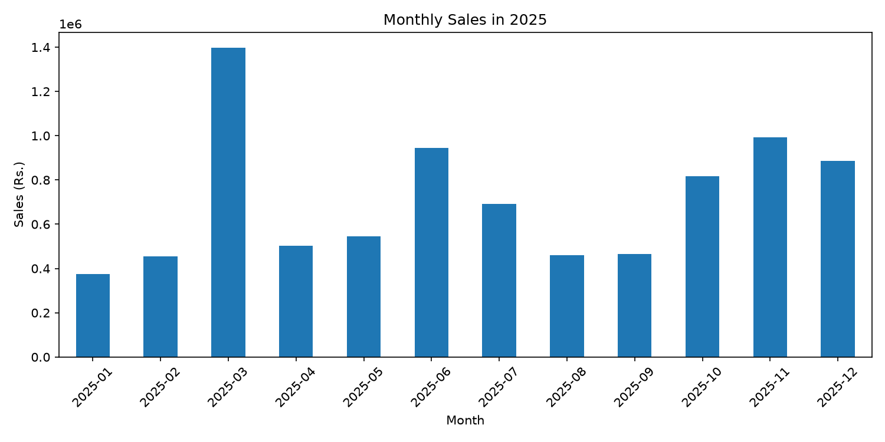
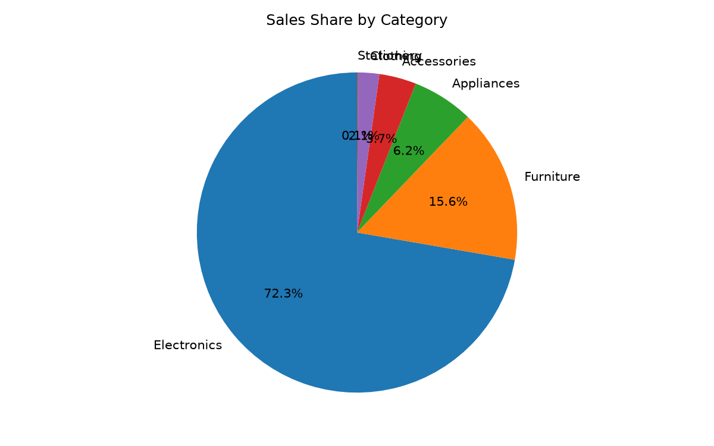
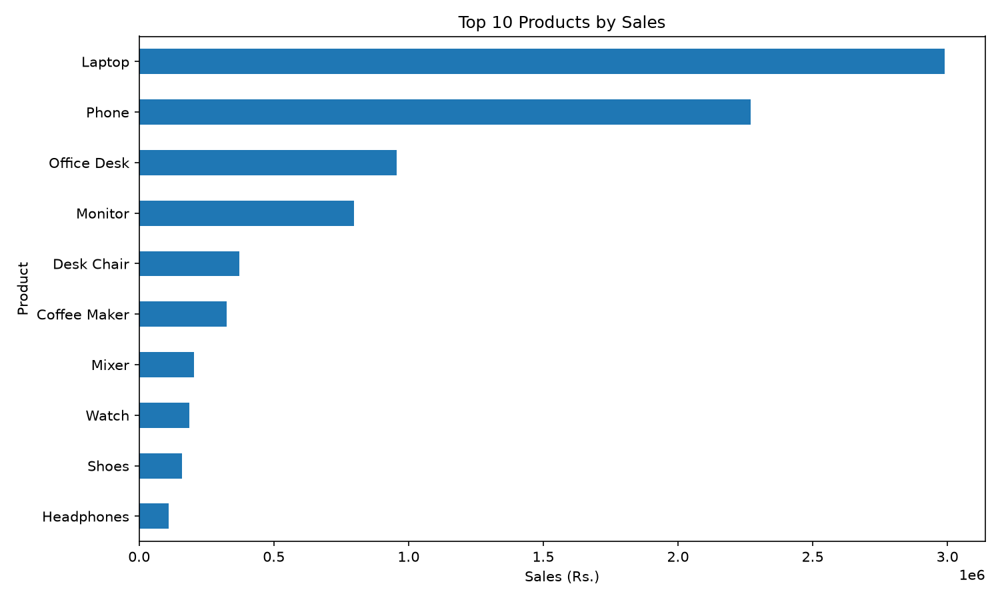
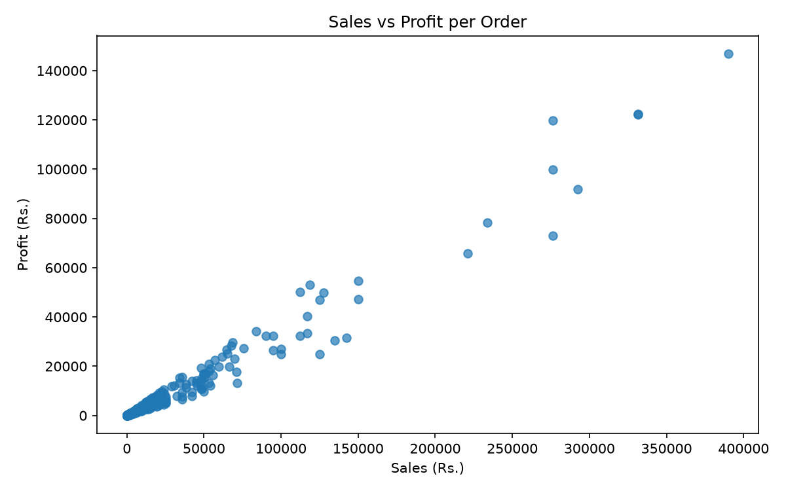
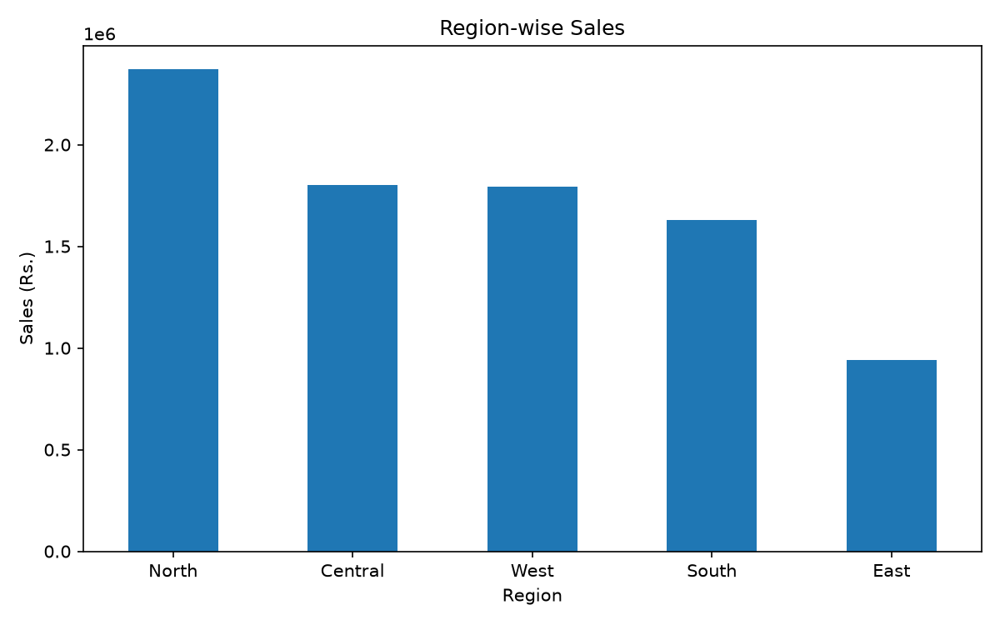

# Sales Data Analysis Project 📊

## Project Overview
A Python-based Sales Data Analysis project that analyzes sales performance, revenue, profit, product categories, and regional trends using Pandas and Matplotlib.

## Technologies Used
- Python
- Pandas
- Matplotlib
- CSV Dataset

## Key Features
- Monthly sales analysis
- Category-wise sales visualization
- Top-selling products analysis
- Sales vs. profit comparison
- Region-wise sales analysis
- Automated generation of five charts

## Project Results
- **Total Orders:** 264
- **Total Sales:** ₹85,34,865
- **Total Profit:** ₹28,01,963.04
- **Total Quantity Sold:** 940
- **Average Order Value:** ₹32,329.03

## Visualizations

### 1. Monthly Sales


### 2. Category Sales


### 3. Top Products


### 4. Sales vs Profit


### 5. Region Sales


## How to Run

Install the dependencies:

```bash
py -m pip install -r Sales_Data_Analysis_Project/requirements.txt
```

Run the analysis:

```bash
py Sales_Data_Analysis_Project/sales_analysis.py
```

## Project Structure

```text
Sales-Data-Analysis/
├── README.md
└── Sales_Data_Analysis_Project/
    ├── sales_analysis.py
    ├── requirements.txt
    ├── README.txt
    ├── data/
    │   └── sales_data.csv
    └── charts/
        ├── 1_monthly_sales.png
        ├── 2_category_sales.png
        ├── 3_top_products.png
        ├── 4_sales_vs_profit.png
        └── 5_region_sales.png
```

## Conclusion
This project demonstrates practical data analysis and visualization skills using Python to identify sales trends, evaluate profitability, and understand business performance.
